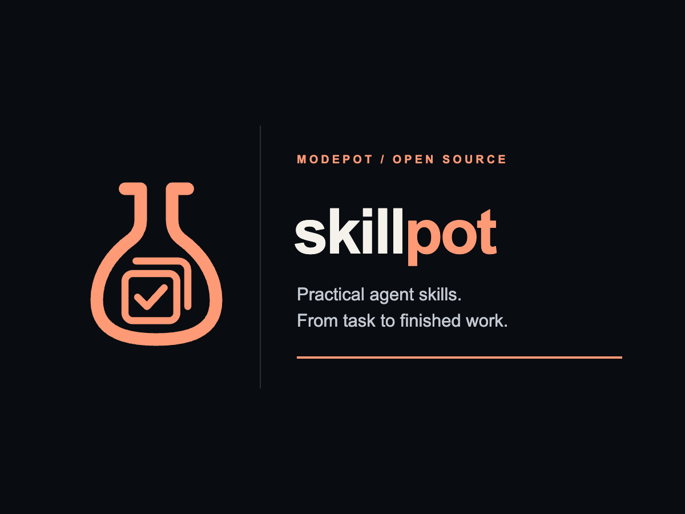
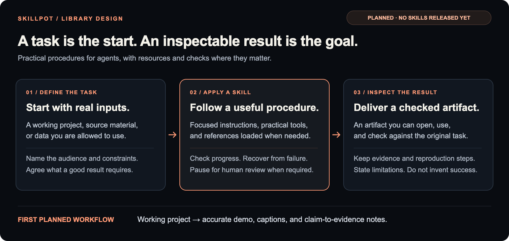

# skillpot

<p align="center">
  
</p>

<p align="center">Part of <a href="https://modepot.io/">ModePot</a>. &nbsp; <a href="https://skillpot.modepot.io/">Documentation</a> &nbsp; <a href="https://tugrul.modepot.io/">Created by Tugrul Guner</a></p>

<p align="center"><strong>Give your agent a workflow. Get work you can inspect.</strong></p>

<p align="center">Task-focused skills with project knowledge, practical procedures and explicit checks.<br>Use the same instruction bundles through Claude Code, Cursor, Codex or Hermes.</p>

<p align="center">
  <a href="https://github.com/tugrulguner/skillpot/releases/latest"></a>
  <a href="https://github.com/tugrulguner/skillpot/actions/workflows/skill-source.yml"></a>
  <a href="LICENSE"></a>
  <a href="https://discord.gg/u3AANZr6RG"></a>
  <a href="https://github.com/tugrulguner/skillpot"></a>
</p>

<p align="center">
  <a href="#quick-start">Quick start</a> ·
  <a href="catalog/README.md">Catalogue</a> ·
  <a href="docs/quickstart.md">Host setup</a> ·
  <a href="docs/skill-contract.md">Authoring reference</a> ·
  <a href="examples/modepot-project-skills/README.md">Examples</a> ·
  <a href="#boundaries">Boundaries</a> ·
  <a href="ROADMAP.md">Roadmap</a> ·
  <a href="CONTRIBUTING.md">Contributing</a>
</p>

## Quick start

The published collection is **[v0.4.1](https://github.com/tugrulguner/skillpot/releases/tag/v0.4.1)**,
with corrections to decision briefs and document action extraction in the same ten-skill collection.
Its immutable release commit is `79284b3faa928dc556a9032aa9dbeb059b4ee915`.
Per-package prerequisites and upstream unreleased-feature boundaries still apply.
See the [release Discussion](https://github.com/tugrulguner/skillpot/discussions/43)
and [preparation/publication record](docs/releases/v0.4.1.md).

Install one skill with one command (Node.js 22.20+ and Git):

```sh
npx skills@1.7.6 add https://github.com/tugrulguner/skillpot/tree/v0.4.1 --skill decision-brief
```

The existing open-source skills CLI downloads the selected complete bundle, creates
its agent links and records its source in `skills-lock.json`. It supports Claude
Code, Cursor, Codex and Hermes among other hosts. Installation is project-local by
default; choose global installation explicitly only if that is what you want.
You do not need to clone this repository or manage skill folders yourself.
See the [automated installation guide](docs/quickstart.md) for choosing one skill,
agent, updates and removal. Installed instructions grant no extra task authority.

<details>
<summary>Advanced: inspect and place the files manually</summary>

Choose one task, inspect its instructions and copy the **complete selected directory**
into your host's documented skill location. This optional example uses Claude Code's
project scope and the published collection. Run it from a new source location you own:

```sh
(
  set -eu
  git clone --branch v0.4.1 --depth 1 https://github.com/tugrulguner/skillpot.git skillpot-source
  cd skillpot-source
  # Replace with an existing project you own.
  SKILL_ROOT="/absolute/owned-project/.claude/skills"
  mkdir -p "$SKILL_ROOT"
  mkdir "$SKILL_ROOT/intpot-python"
  cp -R skills/intpot-python/. "$SKILL_ROOT/intpot-python/"
)
```

The plain `mkdir` refuses an existing destination, including a same-name symlink.
The immutable v0.4.1 archive retains older v0.4.0 setup examples and prepublication
metadata. Keep the selected v0.4.1 checkout; use this current host guide or the Release's
setup override instead of rerunning an older checkout command from tagged docs.
Preserve local edits rather than merging over them. The selected bundle includes
`SKILL.md`, its pinned upstream guide and complete license notices; downloading the
source does not activate every other skill or install Intpot.

Open Claude Code in the target project and invoke `/intpot-python` with your task,
trusted input and allowed actions. For example:

> Use this skill to export my trusted Intpot App as a standalone CLI. Preserve existing
> files, ask before installing missing dependencies, and explain how to check the result.

Cursor supports `.cursor/skills/` and `.agents/skills/`; Codex uses `.agents/skills/`.
Hermes has an existing selective URL installer. Follow the
[harness-neutral host setup](docs/quickstart.md) for exact placement, invocation,
updates and removal. The host supplies tools and enforces permissions; installing
instructions grants no additional authority.

</details>

## Choose a workflow

Published v0.4.1 contains ten skills, including `decision-brief` and
`document-actions`. Current source contains fourteen workflows, adding the unreleased
`claim-check`, `change-impact`, `bug-repro` and `incident-triage` bundles. Their [claim-check](docs/claim-check-first-use.md),
[change-impact](docs/change-impact-first-use.md), [bug-repro](docs/bug-repro-first-use.md)
and [incident-triage](docs/incident-triage-first-use.md)
automated first-use guides select separate source revisions because the stable release
does not contain these skills.
The original two workflows retain
[published field-consistency corrections](docs/field-consistency.md) to those two
skills. The stable clone above selects their published snapshot; the first-use guides
use its exact commit.
Publication does not promote repository-readiness beyond its experimental scope.

The [current-source hardening guide](docs/skill-hardening.md) records a review of all
fourteen bundles, corrected standalone references and worked-output consistency,
and a fresh individual-installation matrix for every bundle. It includes claim-check
0.1.1; the published ten-skill release remains unchanged.

Current source also contains a [Dexpot-only published-guide refresh](docs/published-upstream-refresh.md):
instruction version 0.3.0 targets Dexpot v0.8.1's path-annotation correction. It is not
in the v0.4.1 collection selected above, which retains Dexpot instruction 0.2.0 and
its v0.8.0 pin. Existing installations and the other nine bundles are unchanged.

| Task | Skill |
| --- | --- |
| Scaffold, inspect or export through the Intpot CLI | [intpot-cli](skills/intpot-cli/SKILL.md) |
| Define, inspect or convert through Intpot's Python API | [intpot-python](skills/intpot-python/SKILL.md) |
| Build typed APIs with bounded agent-owned decisions | [summonpot](skills/summonpot/SKILL.md) |
| Build synchronous typed HTTP APIs | [dexpot](skills/dexpot/SKILL.md) |
| Use the embedded database preview with explicit limits | [refpot-database](skills/refpot-database/SKILL.md) |
| Prepare/review changes specifically in Summonpot | [summonpot-pr-review](skills/summonpot-pr-review/SKILL.md), [summonpot-code-review](skills/summonpot-code-review/SKILL.md) |
| Audit a repository against an exact delivery goal | [repository-readiness](skills/repository-readiness/SKILL.md), experimental |
| Extract stated actions and unresolved questions from documents | [document-actions](skills/document-actions/SKILL.md) 0.1.2, included in v0.4.1; [first-use steps](docs/quickstart.md#try-document-actions-from-pinned-source) |
| Compare alternatives against a bounded evidence packet | [decision-brief](skills/decision-brief/SKILL.md) 0.1.1, included in v0.4.1 |
| Triage symptoms and logs into an evidence-backed investigation handoff | [incident-triage](skills/incident-triage/SKILL.md) 0.1.0, source only; `incident.md` and `timeline.md`; [one-command setup](docs/incident-triage-first-use.md); inspection-only by default |
| Minimize a reported failure into a runnable reproducer and regression test | [bug-repro](skills/bug-repro/SKILL.md) 0.1.0, source only; [one-command setup](docs/bug-repro-first-use.md); execution requires explicit permission |
| Map a code change to evidenced impacts and focused checks | [change-impact](skills/change-impact/SKILL.md) 0.1.0, current source only; produces `impact.md` and `verification.md`; [one-command setup](docs/change-impact-first-use.md) |
| Review a draft's factual claims against bounded evidence | [claim-check](skills/claim-check/SKILL.md) 0.1.1, current source only; [one-command setup](docs/claim-check-first-use.md) |

Consumer guidance and contributor policies are separate choices. Summonpot's review
policies do not govern unrelated projects or authorize a merge. See the
[task-first catalogue](catalog/README.md) for source ownership and scope.

## How the collection works

A skill combines a `SKILL.md` entry point with directly linked references, scripts or
assets where useful. The entry point explains triggers, prerequisites, the procedure,
failure handling and completion checks. Supporting material loads when needed.

Public ModePot project guides remain canonical upstream. SkillPot distributes
reviewed immutable snapshots, preserves complete notices and source hashes, and
records adaptations instead of independently inventing product APIs. The
[machine-readable catalogue](catalog/modepot-sources.json) identifies the exact pins.
Private skill stores are not copied into this library.

The original repository-readiness skill produces a cited report rather than changing
or publishing its target. Its [task and report example](examples/repository-readiness/README.md)
and [compatibility record](skills/repository-readiness/compatibility.md) explain its
experimental scope.

### Original workflow design

<p align="center">
  
</p>

This preserved illustration describes the project's original planned workflow. It is
conceptual design history, not an additional shipped skill, a live agent run or a
requirement to produce videos. The catalogue above describes what is available now.

## Examples and reference

- [Document actions worked example](examples/document-actions/README.md): fictional documents, expected classifications and offline acceptance checks. These are authored fixtures, not observed agent extractions. Included in v0.4.1.
- [Decision brief worked example](examples/decision-brief/README.md): a parent-authored CSV/SQLite comparison, pinned documentation excerpts and four failure cases. Its offline checker validates artifact integrity, not agent performance. Included in v0.4.1.
- [Product consumer examples](examples/modepot-project-skills/README.md): actual sources,
  setup, expected checks and explicit product pins. v0.14.0 Intpot provenance examples
  are distinguished from older runtime records.
- [Host installation guide](docs/project-skill-installation.md): selective resources,
  source inspection and the existing Hermes installer.
- [Skill authoring contract](docs/skill-contract.md): metadata, procedure, permissions,
  resources and maintenance requirements.
- [Release and refresh policy](docs/release-policy.md): immutable collection tags,
  upstream freshness, user-edit preservation and publication readback.
- [Website source](website/): product-owned documentation and build/deployment setup.
  The documentation is live at [skillpot.modepot.io](https://skillpot.modepot.io/).

## Boundaries

- SkillPot distributes instructions, not an agent runtime, MCP replacement, custom
  installer or marketplace. Product dependencies and paid services require separate setup.
- Documented harness integration follows official skill specifications and offline
  source validation. Local account state and live model trials are not integration gates.
- Refpot remains a preview; repository-readiness remains experimental. Keep each
  product's actual prerequisites and supported subset rather than inferring broad support.
- Source checks do not establish universal runtime behavior, safety or improved model
  performance. Skills cannot enforce the host's permission boundary.
- Existing [installation records](evaluations/modepot-project-skills/native-install-001/README.md),
  [consumer replays](evaluations/modepot-project-skills/consumer-tasks-001/README.md) and
  [host observations](evaluations/harness-portability/explicit-codex-001/README.md)
  retain their original pins, failures and assistance. They are historical observations,
  not prerequisites for users of another harness.

## Community and contributing

Join the [ModePot Discord](https://discord.gg/u3AANZr6RG) for questions and exploratory
discussion. Use [GitHub Issues](https://github.com/tugrulguner/skillpot/issues) for
reproducible problems and scoped proposals. Do not include private data or credentials.

Read [CONTRIBUTING.md](CONTRIBUTING.md) for setup/check commands and the
[roadmap](ROADMAP.md) for current work. Useful contributions include clearer procedures,
public examples, source/notice checks and fixes for real failure cases. Discuss
substantial scope before implementation. Repository contributors and coding agents
should read [AGENTS.md](AGENTS.md).

[Star the repository](https://github.com/tugrulguner/skillpot) or bring a concrete task
with inputs, expected output and permissions. Broad usefulness is earned through
maintained workflows, not catalogue size.

## License

[MIT](LICENSE). Incorporated sources retain their complete notices. Third-party tools
and services retain their own licenses and terms.
