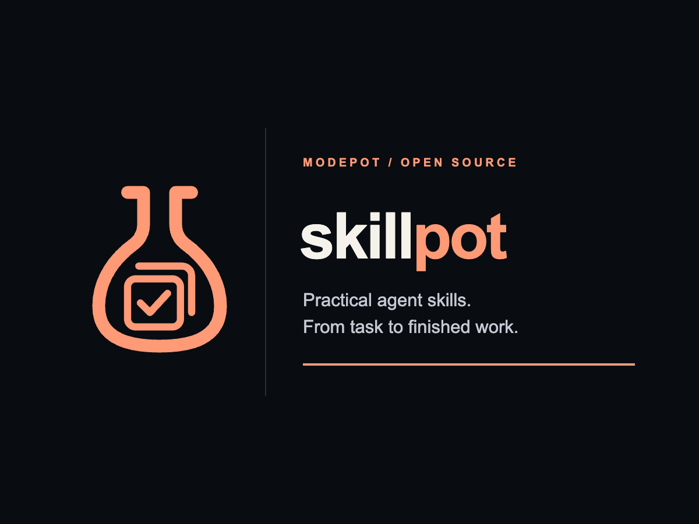
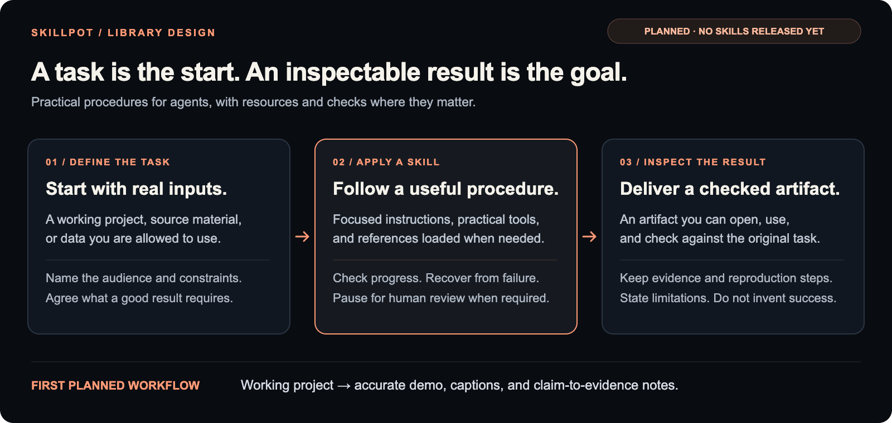

# skillpot

  

Part of <a href="https://modepot.io/">ModePot</a>. &nbsp; <a href="https://tugrul.modepot.io/">Created by Tugrul Guner</a>

  <strong>Give your agent a workflow. Get work you can inspect.</strong>

  Practical, installable agent skills for building, researching, and presenting real work. 
  Clear inputs. Useful artifacts. Explicit checks.

  
  
  
  

  <a href="#why-skillpot">Why SkillPot</a> ·
  <a href="docs/quickstart.md">Quickstart</a> ·
  <a href="#modepot-project-skills">ModePot skills</a> ·
  <a href="#the-first-workflow">First workflow</a> ·
  <a href="#current-status">Status</a> ·
  <a href="#using-skillpot">Using SkillPot</a> ·
  <a href="ROADMAP.md">Roadmap</a> ·
  <a href="#community">Community</a> ·
  <a href="CONTRIBUTING.md">Contributing</a>

  

> [!IMPORTANT]
> SkillPot is in development. Pinned public ModePot project skills and the experimental
> repository-readiness workflow are available in [v0.1.0](https://github.com/tugrulguner/skillpot/releases/tag/v0.1.0).
> Harness setup follows official specifications; see the [quickstart](docs/quickstart.md).

## Why SkillPot?

A capable agent can still leave you with work to finish: a demo that does not show the
actual product, a report whose claims cannot be traced, or an analysis that cannot be
reproduced. More instructions are not enough if the workflow never checks the result.

SkillPot is being built around complete tasks. A skill should explain what it needs,
choose appropriate tools, produce a useful artifact, and check it before calling the
work finished. The intended audience is builders, researchers, and creators—not only
people using ModePot projects.

The library's design principles are:

- **An outcome, not a persona.** Name the task and deliverable instead of asking the
  agent to pretend to be an expert.
- **Procedure plus practical resources.** Bundle scripts, examples, templates, and
  references when they make the work more reliable.
- **Checks that match the claim.** Validate the artifact; do not confuse clean Markdown
  or a convincing response with successful execution.
- **Small, selectively installed skills.** Keep the active instructions focused and
  load supporting material only when it is needed.
- **Visible boundaries.** Document prerequisites, permissions, supported environments,
  review points, and known failures.

These are the bar for future skills, not claims that an unreleased library has already
met it. Evaluation and maintenance support the work; they are not a guarantee that an
agent will always follow instructions.

## ModePot project skills

The collection now includes pinned public project guidance—not only the original
repository-readiness experiment:

- **Intpot:** [CLI](skills/intpot-cli/SKILL.md) and [Python API](skills/intpot-python/SKILL.md).
- **Summonpot:** [consumer workflow](skills/summonpot/SKILL.md), plus project-scoped
  [PR review](skills/summonpot-pr-review/SKILL.md) and
  [code review](skills/summonpot-code-review/SKILL.md).
- **Dexpot:** [synchronous typed HTTP applications](skills/dexpot/SKILL.md).
- **Refpot:** [embedded database preview](skills/refpot-database/SKILL.md).

Each can be installed separately through an existing host mechanism; there is no
all-skills auto-install or hidden product dependency installation. Start with the
[catalogue](catalog/README.md) and [installation guide](docs/project-skill-installation.md).
Upstream repositories remain canonical. Source revisions, original guide hashes and
complete MIT notices are preserved; this is a pinned distribution, not a second API
manual tracking main silently.

The public inventory found no existing skill Markdown in Utilitypot, Lifepot or
Strpot at the inspected revisions, so none is invented for those projects. Private
local skills are not copied. See the [bounded inventory](catalog/source-inventory.json)
and each package's provenance/compatibility records for scope and verification limits.
Packaging or installation is not proof of a full product runtime or usefulness matrix.

## The first workflow

**A repository and a delivery goal → an evidence-backed readiness report.**

Use [repository-readiness](skills/repository-readiness/SKILL.md) when you need to know
whether a project is ready for a specific installation, handoff or release. The skill
guides an agent to pin the source, trace the consumer path, inspect and run authorized
checks, separate verified behavior from claims, and deliver blockers with citations
and concrete next steps. It does not modify or publish the project implicitly.

The deliverable is the report and actual check evidence—not a recording, generic
review persona, custom runtime or test harness. See the
[task and frozen rubric](examples/repository-readiness/task.md). Source validation is
not evidence of agent execution; explicit loading is not automatic host discovery.
The [current proposal](docs/repository-readiness-proposal.md) defines these boundaries.

Research-to-explainer and data-to-decision workflows are later candidates, not committed
features. A future catalogue must earn its breadth one useful skill at a time.

## Current status

| Area | Status |
| --- | --- |
| Project direction and first-workflow scope | Documented |
| Public roadmap and contribution guidance | Available in this repository |
| ModePot-family logo and editable artwork | Available in [assets/](assets/README.md) |
| Experimental skill source | [repository-readiness](skills/repository-readiness/SKILL.md) and report template |
| ModePot public collection | [Seven pinned project/contributor packages](catalog/README.md) |
| Native selective installation | [Seven Hermes install/list/remove checks](evaluations/modepot-project-skills/native-install-001/README.md); not model activation |
| ModePot consumer execution | [Refpot plus Intpot/Dexpot/Summonpot examples](examples/modepot-project-skills/README.md); bounded, partly assisted checks, not a runtime matrix |
| Real task example | [Frozen public repository task](examples/repository-readiness/task.md) |
| Versioned collection releases | [v0.1.0](https://github.com/tugrulguner/skillpot/releases/tag/v0.1.0); [release policy](docs/release-policy.md) |
| Documented host integration | Claude Code, Cursor, Codex and Hermes; [official-contract setup](docs/quickstart.md) |
| Cross-harness execution | [Codex CLI explicit skill use and CLI task](evaluations/harness-portability/explicit-codex-001/README.md); other host observations scoped separately |
| Initial agent smoke and baseline | [Observed attempts and evidence defects](evaluations/repository-readiness/initial-smoke/README.md); no benefit established |
| Repaired-version task execution | [Accepted bounded audit smoke](evaluations/repository-readiness/repaired-smoke/README.md); no broader qualification |
| Repeated/held-out usefulness evaluation | Not established |
| Standalone website, registry, or custom installer | Not provided |

A standard skill format does not imply identical tool access, permissions, activation,
or behavior across agents. Integration follows each host's published contract; actual
runtime observations remain scoped to their recorded environments. Local logins and
live model trials are not setup or collection-release gates.

## Using SkillPot

Start with the [harness-neutral quickstart](docs/quickstart.md): choose a task, inspect
and pin the source, copy the complete selected skill into your agent's project skill
directory, then invoke it and check the real result. Claude Code, Cursor, Codex and
Hermes are example hosts, not SkillPot dependencies. Host-specific discovery and
permissions differ; portable format does not establish universal tested support.

For an explicit-load experiment, ask your agent to read
`skills/repository-readiness/SKILL.md`, then give it the repository, exact delivery
question, allowed checks and an output destination. For example:

> Read the repository-readiness skill. Inspect this checkout and determine whether a
> new user can install and complete its documented task. Do not change it. Run only
> authorized offline checks and produce a report with source citations, actual command
> results, blockers and the smallest next steps.

The [example](examples/repository-readiness/README.md) identifies the frozen input and
execution boundaries. This is explicit instruction loading, not a verified native
installation command. See [compatibility](skills/repository-readiness/compatibility.md),
the [authoring contract](docs/skill-contract.md), and [roadmap](ROADMAP.md) for scope
and the [release policy](docs/release-policy.md) for publication gates. The earlier
[demo proposal](docs/first-workflow-proposal.md) is historical, not the current target.

Packaging follows the open [Agent Skills format](https://agentskills.io/): a `SKILL.md`
entry point with optional scripts, references, and assets. The public project collection
on `main` has [host-specific placement and Hermes installation guidance](docs/project-skill-installation.md).
This installation evidence does not establish model activation, another host, or every
product runtime. The original repository-readiness workflow remains an explicit-load
experiment with its own qualification limits.

SkillPot is not an agent runtime, an MCP replacement, a new skill standard, or a skill
marketplace. Skills provide procedures; the host agent supplies execution and enforces
its own permission boundary. Some workflows may need external tools or paid services;
those requirements and costs must be disclosed before use.

## What a published skill must include

1. **A specific task and useful output.** State when the skill applies—and when it does not.
2. **An explicit environment.** List tools, dependencies, credentials, costs, and access needs.
3. **A complete procedure.** Include setup, checks, failure handling, and recovery where relevant.
4. **Inspectable examples.** Supply runnable examples or fixtures, not invented transcripts.
5. **Checks matched to claims.** Validate source, resources and examples. Repeated
   comparative trials are needed for improvement claims, not ordinary format support.
6. **Maintenance and provenance.** Record source permissions, tested revisions, limitations,
   and who maintains the skill.

No credentials, private project data, personal machine paths, or unlicensed third-party
instructions belong in the public library. Scripts and external references require
review. A skill is not a sandbox or a security certification.

## Community

Join the [ModePot Discord](https://discord.gg/u3AANZr6RG) for workflow ideas, implementation
questions, and discussion across the project family.

Use [GitHub Issues](https://github.com/tugrulguner/skillpot/issues) for reproducible
problems, scoped proposals, and realistic tasks we can evaluate. When proposing a skill,
show the input, desired artifact, current approach, and what makes the result acceptable.
Do not include secrets or private source material.

## Contributing

Read [CONTRIBUTING.md](CONTRIBUTING.md) and the [roadmap](ROADMAP.md) before substantial
work. The most useful early contributions are representative task cases, source-permission
checks, failure examples, and evidence that a workflow improves on an existing approach.

Existing project skills may be candidates for extraction, but they must be audited
against current behavior, stripped of private assumptions, and checked for redistribution
rights. Being present in another repository is not evidence that a skill is current.

## Support SkillPot

If the direction is useful, [star the repository](https://github.com/tugrulguner/skillpot)
or bring a real task to the issue tracker. Useful examples and honest failure reports
will help shape the first release more than a large untested catalogue.

## License

[MIT](LICENSE). Third-party tools and source materials retain their own licenses.
