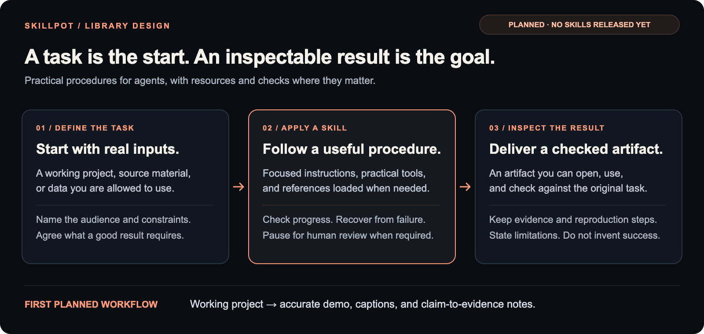

import SkillExcerpt from '../../components/SkillExcerpt.astro';

## Install one skill

The published collection has eight skills: seven public project/contributor packages and the original experimental repository-readiness workflow. Choose one task from the [catalogue](/catalogue/). Claude Code, Cursor, Codex and Hermes are example hosts, not SkillPot dependencies.

<strong>Get the published source</strong><code>{'git clone --branch v0.4.0 --depth 1 https://github.com/tugrulguner/skillpot.git skillpot-source'}</code><a href="/quickstart/">Copy one selected skill →</a>

Downloading source does not activate every skill or install any product dependency. The [quick start](/quickstart/) shows the complete-directory copy and refuses an existing destination. Use the host's existing permissions and ask before dependencies, paid services or publication.

## How a skill works

<SkillExcerpt />

The entry point describes when the workflow applies, its prerequisites, procedure, failure cases and completion checks. References load when needed. Source revisions and full licenses remain inspectable. Hosts supply execution tools; instructions do not grant extra authority.

## Choose the work

- **Intpot:** CLI and Python workflows, including versioned conversion and diagnostic limits.
- **Summonpot:** typed APIs with bounded agent-owned decisions, plus separate project contributor reviews.
- **Dexpot:** synchronous typed HTTP APIs.
- **Refpot:** the embedded database preview, with explicit data and durability limits.
- **Repository readiness:** an experimental, cited delivery audit without implicit target changes.

Published v0.4.0 includes **decision-brief**. It produces a proposed recommendation and evidence ledger from a bounded source packet; it does not implement the decision. See the [catalogue entry](/catalogue/) and its worked example. The stable clone above supplies all ten published skills.

Published v0.4.0 also includes **document-actions**. It extracts stated actions into `actions.md` and unresolved questions into `questions.md`, keeping proposals and historical items separate and missing owners or dates explicit. See the [catalogue and release-pinned first-use steps](/catalogue/); it does not assign work, create tickets or send messages.

[Browse the ten published skills](/catalogue/) or read the [host setup](/host-setup/).

## Original workflow design

<figure className="workflow"><figcaption><strong>Planned direction—not a released workflow.</strong> Preserved original design artwork. This is not an additional skill, a live agent run or a requirement to create videos.</figcaption></figure>

## Boundaries and maintenance

Refpot remains a preview and repository-readiness remains experimental. The upstream projects own product APIs; this collection distributes reviewed immutable guides, not independently evolving manuals. Installation and source checks do not prove improved model performance or universal runtime behavior.

Learn the [authoring contract](/authoring/), [provenance and refresh rules](/provenance-refresh/), and [scope limits](/limits/). Each guide has a Markdown download generated from the same canonical repository source used for its HTML.

Coding agents can start with the [agent documentation map](/llms.txt).

