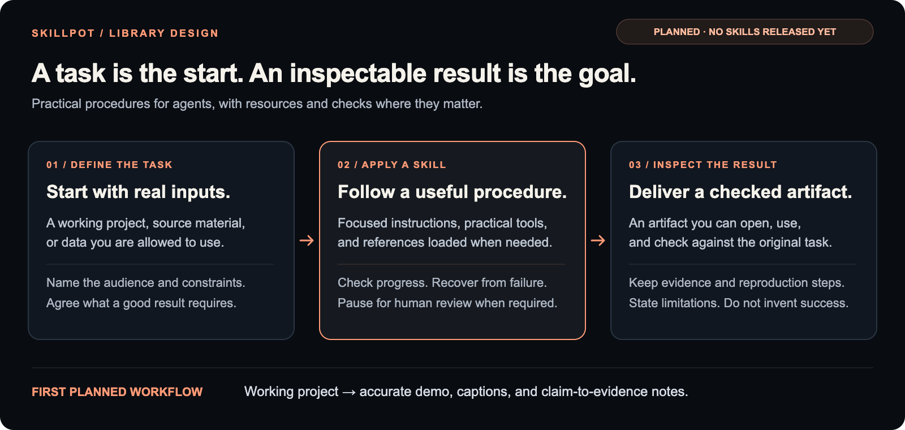

import SkillExcerpt from '../../components/SkillExcerpt.astro';

## Install one skill

Published v0.5.0 contains seventeen skills: ten retained workflows and seven additions—claim-check 0.1.1, verification-loop 0.2.0 and five workflows at 0.1.0. Each keeps its existing task permissions and maturity boundaries; publication is not an efficacy claim. Choose one task from the [catalogue](/catalogue/). Claude Code, Cursor, Codex and Hermes are example hosts, not SkillPot dependencies.

<strong>Install one published skill</strong><code>{'npx skills@1.7.6 add https://github.com/tugrulguner/skillpot/tree/044213fd00343e94b4d389c3ca2c0f2909feb79f --skill claim-check'}</code><a href="https://github.com/tugrulguner/skillpot/blob/main/docs/claim-check-first-use.md">Claim-check first-use guide →</a>

This installs only claim-check from the immutable v0.5.0 release using the standard Skills CLI; Node.js 22.20+ and Git are required. Publication does not establish task efficacy. For the stable release, see [v0.5.0](https://github.com/tugrulguner/skillpot/releases/tag/v0.5.0) and the [quick start](/quickstart/). Installation does not install product dependencies. Use the host's existing permissions and ask before dependencies, paid services or publication.

Published **benchmark-audit** reviews existing benchmark evidence into `benchmark-audit.md`, with four claim-level verdicts and explicit evidence boundaries. Inspection-only; it does not run benchmarks or models. See the [benchmark-audit first-use guide](https://github.com/tugrulguner/skillpot/blob/main/docs/benchmark-audit-first-use.md); source availability is not task-efficacy evidence.

## How a skill works

<SkillExcerpt />

The entry point describes when the workflow applies, its prerequisites, procedure, failure cases and completion checks. References load when needed. Source revisions and full licenses remain inspectable. Hosts supply execution tools; instructions do not grant extra authority.

## Choose the work

- **Intpot:** CLI and Python workflows, including versioned conversion and diagnostic limits.
- **Summonpot:** typed APIs with bounded agent-owned decisions, plus separate project contributor reviews.
- **Dexpot:** synchronous typed HTTP APIs.
- **Refpot:** the embedded database preview, with explicit data and durability limits.
- **Repository readiness:** an experimental, cited delivery audit without implicit target changes.

Published v0.5.0 includes **decision-brief**. It produces a proposed recommendation and evidence ledger from a bounded source packet; it does not implement the decision. See the [catalogue entry](/catalogue/) and its worked example. The stable v0.5.0 quick start covers all seventeen published skills.

Published v0.5.0 also includes **document-actions**. It extracts stated actions into `actions.md` and unresolved questions into `questions.md`, keeping proposals and historical items separate and missing owners or dates explicit. See the [catalogue and release-pinned first-use steps](/catalogue/); it does not assign work, create tickets or send messages.

Published **change-impact** maps a specified code change to evidenced callers, contracts and focused checks, producing `impact.md` and `verification.md`. It does not modify code or run tests without authorization. See its [one-command first-use guide](https://github.com/tugrulguner/skillpot/blob/main/docs/change-impact-first-use.md); static links are not runtime-reachability proof.

Published **bug-repro** turns an authorized bug investigation into a minimal runnable reproducer, a regression test and `repro.md` with actual evidence. It does not execute unapproved code or silently fix the product. See its [bug-repro first-use guide](https://github.com/tugrulguner/skillpot/blob/main/docs/bug-repro-first-use.md); Not reproduced and Blocked remain valid outcomes.

Published **incident-triage** turns bounded symptoms and logs into `incident.md` and `timeline.md`, separating observed impact, source-linked events, hypotheses and next checks. It is inspection-only by default, without automatic diagnostics or remediation. See the [incident-triage first-use guide](https://github.com/tugrulguner/skillpot/blob/main/docs/incident-triage-first-use.md); a passing retry does not establish a fixed cause.

Published **verification-loop** 0.2.0 runs checks within existing local authorization and produces evidence-linked `verification.md`. Without execution permission it plans only; repairs require permission. Optional setup qualifies reusable project recipes, and recurring misses become owner-reviewed diff-triggered rule candidates. See the [verification-loop first-use guide](https://github.com/tugrulguner/skillpot/blob/main/docs/verification-loop-first-use.md). Authored generated-input examples and source checks do not establish agent efficacy.

Published **experiment-design** turns a bounded decision into a falsifiable,
prospective `experiment.md` with competing explanations, controls, unit/repetition
rationale, a frozen full schedule and permission-aware handoff. Inspection/planning
only; blocked and no-new-experiment are valid outcomes. No experiments, benchmarks or
models are run. The accepted retrospective fixture and expected oracle stay outside
installed practice inputs. See the [experiment-design first-use guide](https://github.com/tugrulguner/skillpot/blob/main/docs/experiment-design-first-use.md).

**Invariant-audit 0.1.0** is current source-only, not in stable v0.5.0: it inspects one
named guarantee against bounded source/observations and produces seven-section
`invariant-audit.md`. Inspection-first; existing explicit bounded execution permission
may be reused only after command/side-effect inspection, otherwise propose the smallest
next check. This is not formal proof; no target-execution or efficacy claim. Its separately
pinned nine-file bundle passed isolated installation, hash, lock, list and removal checks
with sibling preservation. See the [first-use guide](https://github.com/tugrulguner/skillpot/blob/main/docs/invariant-audit-first-use.md).

[Browse all seventeen published skills](/catalogue/) or read the [host setup](/host-setup/).

## Original workflow design

<figure className="workflow"><figcaption><strong>Planned direction—not a released workflow.</strong> Preserved original design artwork. This is not an additional skill, a live agent run or a requirement to create videos.</figcaption></figure>

## Boundaries and maintenance

Refpot remains a preview and repository-readiness remains experimental. The upstream projects own product APIs; this collection distributes reviewed immutable guides, not independently evolving manuals. Installation and source checks do not prove improved model performance or universal runtime behavior.

Learn the [authoring contract](/authoring/), [provenance and refresh rules](/provenance-refresh/), and [scope limits](/limits/). Each guide has a Markdown download generated from the same canonical repository source used for its HTML.

Coding agents can start with the [agent documentation map](/llms.txt).

